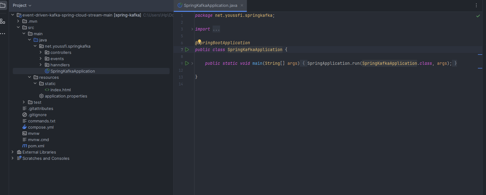
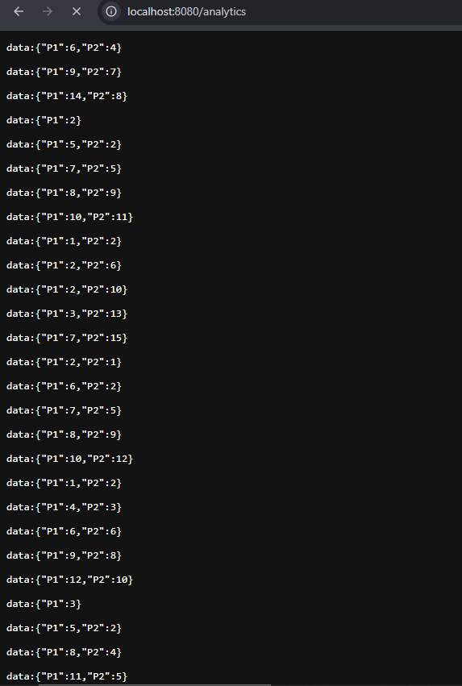
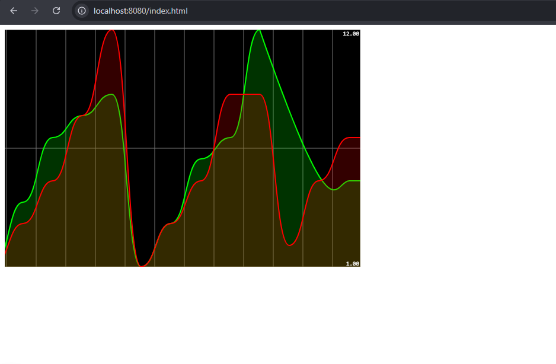
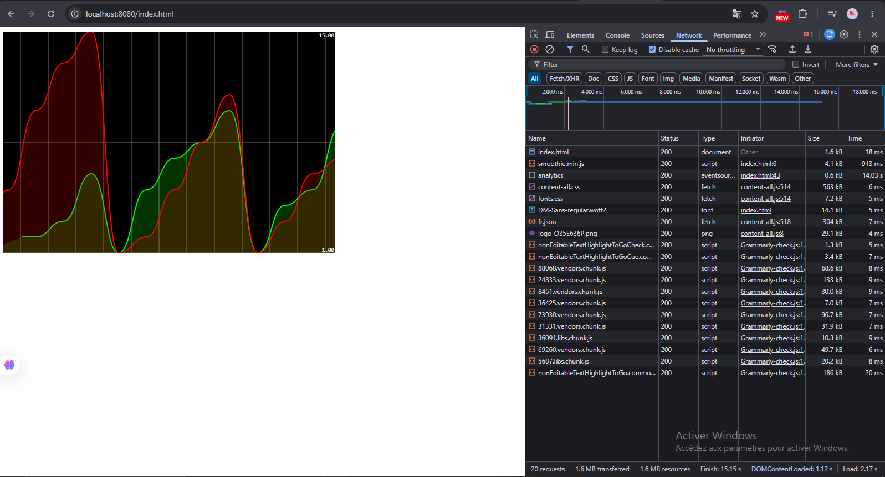

# Agrigah : Event Driven Architecture avec Kafka et Spring Cloud Stream

Projet réalisé dans le cadre d'un TP sur les architectures pilotées par les événements.
Il utilise **Apache Kafka**, **Spring Cloud Stream** et **Kafka Streams** pour produire, consommer
et analyser des événements en temps réel, avec une page web qui affiche les résultats.

## Objectifs du TP

1. Démarrer Kafka avec Docker (Zookeeper et broker) et le tester avec `kafka-console-producer` et `kafka-console-consumer`.
2. Créer un **Producer** Kafka exposé par un contrôleur REST.
3. Créer un **Consumer** Kafka.
4. Créer un **Supplier** Kafka qui génère des événements automatiquement.
5. Réaliser un traitement **temps réel** avec Kafka Streams.
6. Afficher les résultats de l'analyse en temps réel dans une application web.

## Architecture

```
Supplier (pageEventSupplier) --> topic T6 --> Kafka Streams (kStream) --> topic T7
                                                    |
                                               count-store
                                                    |
                                      GET /analytics (flux SSE)
                                                    |
                                      index.html (SmoothieChart)

GET /publish (Producer REST) --> topic choisi --> Consumer (pageEventConsumer, topic T1)
```

| Composant | Rôle | Topic |
|---|---|---|
| `PageEventController` `/publish` | Producer REST : envoie un événement avec `StreamBridge` | topic donné en paramètre |
| `pageEventConsumer` | Consumer : affiche chaque événement dans la console | `T1` (entrée) |
| `pageEventSupplier` | Supplier : génère un événement aléatoire (P1 ou P2) toutes les 200 ms | `T6` (sortie) |
| `kStream` | Kafka Streams : compte les événements par page sur une fenêtre de 5 secondes | `T6` (entrée), `T7` (sortie) |
| `PageEventController` `/analytics` | Lit le store `count-store` et envoie les valeurs chaque seconde (SSE) | : |
| `static/index.html` | Affiche les courbes P1 et P2 en temps réel | : |

L'événement `PageEvent` contient : `name` (page), `user`, `date` et `duration`.

## Technologies

- Java 17
- Spring Boot 3.4.2
- Spring Cloud Stream 2024.0.0 (binders Kafka et Kafka Streams)
- Apache Kafka et Zookeeper (images Confluent 7.3.0)
- Docker et Docker Compose
- Maven
- SmoothieChart (JavaScript)

## Structure du projet

```
agrigah
|-- doc/                       Captures d'écran
|-- src
|   |-- main
|   |   |-- java/net/agrigah/springkafka
|   |   |   |-- controllers/   PageEventController (Producer REST et /analytics)
|   |   |   |-- events/        PageEvent
|   |   |   |-- hanndlers/     PageEventHandler (Consumer, Supplier, Kafka Streams)
|   |   |   `-- SpringKafkaApplication.java
|   |   `-- resources
|   |       |-- static/index.html
|   |       `-- application.properties
|   `-- test
|-- commands.txt               Commandes Kafka utilisées pendant le TP
|-- compose.yml                Zookeeper et broker Kafka
`-- pom.xml
```

## Prérequis

- JDK 17 ou supérieur
- Docker Desktop (sous Windows, au moins 4 Go de RAM alloués à WSL2)
- Maven (le wrapper `mvnw` est fourni dans le projet)

## Lancer le projet

### 1. Démarrer Kafka et Zookeeper

```bash
docker compose -f compose.yml up -d
docker ps
```

Les conteneurs `zookeeper` et `broker` doivent être `Up`. Attendre environ 30 secondes avant de lancer l'application.

### 2. Démarrer l'application Spring Boot

```powershell
# Windows PowerShell
.\mvnw.cmd spring-boot:run
```

```bash
# Linux / macOS
./mvnw spring-boot:run
```

### 3. Ouvrir l'interface

- Graphique en temps réel : <http://localhost:8080/index.html>
- Flux de données brut : <http://localhost:8080/analytics>

> Ouvrir la page sur le port **8080** (Spring Boot), et non sur le serveur de prévisualisation de l'IDE (port 63342).

### 4. Arrêter

```bash
docker compose -f compose.yml down
```

## Configuration

Fichier `src/main/resources/application.properties` :

```properties
spring.application.name=spring-kafka
spring.cloud.stream.bindings.pageEventConsumer-in-0.destination=T1
spring.cloud.stream.bindings.pageEventSupplier-out-0.destination=T6
spring.cloud.stream.poller.fixed-delay=200
spring.cloud.stream.bindings.kStream-in-0.destination=T6
spring.cloud.stream.bindings.kStream-out-0.destination=T7
spring.cloud.function.definition=pageEventConsumer;pageEventSupplier;kStream
spring.cloud.stream.kafka.streams.binder.configuration.commit.interval.ms=1000
```

## Tests

### Producer REST

Envoyer un événement vers le topic `T1` (lu par le consumer) :

```
http://localhost:8080/publish?name=P1&topic=T1
```

La réponse est l'événement en JSON, et il s'affiche dans la console de l'application entre deux lignes d'étoiles.

### Console Kafka

```bash
# Événements générés par le Supplier
docker exec -it broker kafka-console-consumer --bootstrap-server localhost:9092 --topic T6 --from-beginning

# Résultat du traitement Kafka Streams
docker exec -it broker kafka-console-consumer --bootstrap-server localhost:9092 --topic T7 --from-beginning \
  --property print.key=true \
  --property key.deserializer=org.apache.kafka.common.serialization.StringDeserializer \
  --property value.deserializer=org.apache.kafka.common.serialization.LongDeserializer

# Lister les topics
docker exec -it broker kafka-topics --bootstrap-server localhost:9092 --list
```

## Résultats

### Structure du projet



### Flux de données `/analytics`

Le flux envoie chaque seconde le nombre d'événements par page, par exemple `data:{"P1":6,"P2":4}`.



### Graphique en temps réel

Courbe verte : page **P1**. Courbe rouge : page **P2**. Les valeurs retombent à zéro toutes les 5 secondes, à chaque nouvelle fenêtre de comptage.



### Requête `/analytics` dans les outils du navigateur



## Problèmes courants

| Problème | Cause et solution |
|---|---|
| `/analytics` renvoie 500 | Le broker Kafka n'est pas démarré ou vient de s'arrêter. Vérifier avec `docker ps`, puis redémarrer avec `docker compose -f compose.yml down -v` et `up -d`. |
| `/analytics` renvoie `data:{}` | Le Supplier n'a pas encore envoyé d'événements. Attendre 10 secondes après le démarrage. Vérifier `spring.cloud.function.definition`. |
| Graphique vide | La page est ouverte sur le port 63342 au lieu de 8080. |
| `.\mvnw.cmd` introuvable dans PowerShell | Ajouter le préfixe `.\` devant la commande. |
| `release version 5 not supported` | Définir Java 17 dans `pom.xml` (`java.version`) et dans IntelliJ (Project Structure). |

## Auteur

Projet **agrigah**, réalisé dans le cadre du TP Event Driven Architecture.